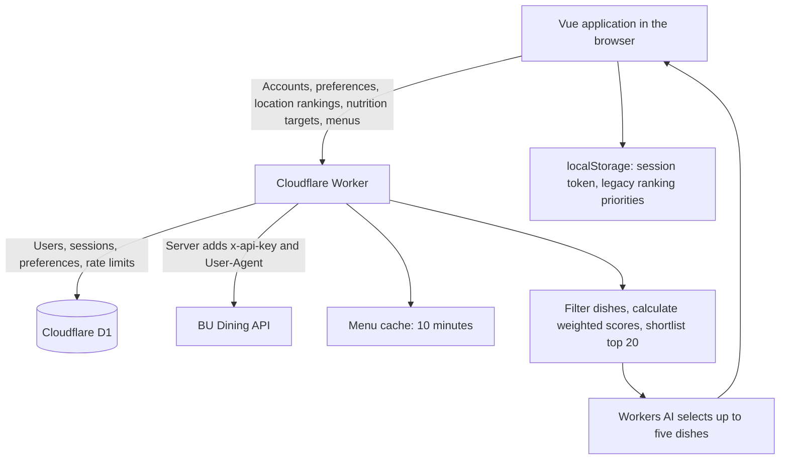

# BU Campus Dining

A dining hall and dish recommendation project for Boston University students. Sign in, save dietary requirements and food preferences, choose which dining halls to include, set nutrition targets, and compare dishes for a selected date and meal.

The application supports Warren Towers (`warren`), West Campus (`west`), and Marciano Commons (`marciano`). The frontend uses Vue 3, Vite, and custom CSS, without a UI component library.

**All backend logic runs on a Cloudflare Worker.** The former local Python prototype (`preference_server.py`, `user.py`, `userdata.py`, `dining_api.py`) has been removed. Accounts, dietary preferences, location rankings, nutrition targets, and BU menu access are served by the Worker and stored per account in Cloudflare D1. Nothing besides the Vite dev server needs to run locally.

## Contents

- [Architecture and request flow](#architecture-and-request-flow)
- [How a recommendation is generated](#how-a-recommendation-is-generated)
- [Feature logic](#feature-logic)
- [Data storage](#data-storage)
- [Worker API and AI recommendation pipeline](#worker-api-and-ai-recommendation-pipeline)
- [Local development](#local-development)
- [Build and deployment](#build-and-deployment)
- [Code map and verification](#code-map-and-verification)
- [Troubleshooting and current limitations](#troubleshooting-and-current-limitations)

## Architecture and request flow

The repository contains both the frontend and backend:

```text
DS-X-Hackathon-Project.github.io/
├── src/                             # Vue frontend
└── worker/                          # Worker, migrations, and backend tests
```

The original workspace directory `Cloudflare_Part` is retained as a reference; develop and deploy the backend from this repository's `worker/` directory.



The browser sends the user's session token to the Worker, which adds its BU API key to upstream menu requests. The BU key is never sent to the browser or included in the frontend bundle.

## How a recommendation is generated

### Hybrid recommendation model

The current system combines **rule-based filtering, weighted scoring, and LLM selection**. It has not removed all rule-based recommendation logic:

- **Rules determine eligibility:** required dietary labels and excluded dining halls are applied before scoring. Selected menu stations are also excluded.
- **Deterministic scores create the shortlist:** nutrition target matching, food keyword matching, and location ranks produce a weighted score. The top 20 candidates are sent to Workers AI.
- **The LLM makes the final selection:** it receives user preferences, candidate scores, and effective weights, and selects up to five dishes with reasons. It can only choose from the supplied shortlist; it cannot recommend a filtered-out dish or one outside the top 20, or change the scoring weights.
- **Weighted scores provide a fallback:** if AI is unavailable, times out, or produces unusable output, the Worker returns the highest-scoring dishes. If AI selects fewer than five valid dishes, weighted picks fill the remaining places when candidates are available.

The former frontend priority-by-priority comparison (compare priority 1, then priority 2 only for ties, then priority 3) has been removed from the main recommendation flow. Hard filters, numerical scoring, and deterministic fallback remain part of the current design. Food keyword scoring is still text matching rather than semantic matching by the LLM.

### Request flow

1. `src/main.js` mounts `App.vue`. The app reads the saved browser session and validates it through the Worker's `/api/auth/me` endpoint.
2. The app shows registration/sign-in when there is no valid session, or the preference and recommendation panels after successful authentication.
3. The user edits dietary needs, food keywords, location rankings, nutrition targets for one dish, and ranking priorities. There are no separate save buttons on the main page.
4. Clicking **Save and recommend** validates every panel before writing anything, saves the current preferences, then sends the selected date, meal, and included locations to `POST /api/recommend`. If validation or saving fails, it does not request recommendations. Saves use separate API calls, so a server failure can leave some panels saved; the page reports the error and lets the user retry.
5. The Worker loads the account's saved preferences, nutrition goals, location rankings, and scoring settings from D1, then fetches menus using the server-side key.
6. It normalizes menu items, applies dietary and location filters, and scores the remaining dishes using the active preference weights.
7. Workers AI receives the top 20 scored candidates, user preferences, and effective weights. Its selections are validated against those candidates. If AI fails, the Worker uses the highest-scoring dishes.
8. The page displays up to five recommendations with reasons, score breakdowns, and effective scoring weights. See [Recommendation priorities](#recommendation-priorities-weighted-scoring-and-advanced-mode) for why these weights can differ from the configured values.

## Feature logic

### Account registration, sign-in, and sessions

- Registration accepts a valid `@bu.edu` email address. The server trims the email and converts it to lowercase.
- Passwords must contain 8–128 JavaScript string units. Password whitespace is preserved.
- The Worker stores a PBKDF2-SHA-256 password hash using 100,000 iterations and a random salt, rather than a plaintext password.
- Registration signs the user in automatically. Each sign-in creates a random session token. The browser stores the token and expiry in `bu-auth-session`; D1 stores only the token's SHA-256 hash.
- Sessions last a fixed seven days and do not extend on access. The server decides whether a session has expired. Multiple devices can hold independent sessions.
- Reloading the page calls `/me`. A 401 clears the session and requests sign-in; a temporary network failure preserves the session and offers a retry.
- Signing out revokes the current token on the Worker before clearing local session data. Other sessions remain valid.
- Email ownership verification, password resets, and sign-in brute-force rate limiting are not implemented. Checking an email's domain is not proof of student identity.

### Dietary needs: mandatory filters

The available requirements are Vegetarian, Vegan, Gluten-free, and Halal. Selecting several applies an AND condition: each dish must satisfy every selected requirement.

Vegan dishes also satisfy Vegetarian. Saving Vegan also sets the Vegetarian preference. Other required labels must explicitly be `true`; a missing label does not count as a match. With no dietary labels selected, this filtering stage leaves all candidates eligible.

Dietary requirements always run before ranking. A preferred location or a better nutrition match cannot compensate for failing a required label. Labels come from BU's menu data; the project does not independently verify ingredients, allergens, or preparation practices.

### Food preferences: keyword matching

- Food preferences accept up to 300 characters and are saved with the user's Worker account preferences.
- Scoring extracts up to 20 unique English words of at least three letters, removes stop words, and ignores case.
- It matches keywords against dish names and descriptions, including simple plural handling. The food score is `100 × matched keywords / total keywords`; English keywords work best.
- This numerical score uses text matching. The LLM also receives the preferences when selecting and explaining recommendations.
- Keywords affect ordering only. Dishes with no keyword match remain eligible.
- Unmatched keywords contribute zero to the food score; they do not cause dishes to be rejected.

### Location preferences: ordering and exclusion

Each included location receives a unique rank from 1 to 3; lower values are preferred. The interface prevents duplicate ranks and requires at least one included location before saving or requesting recommendations.

Choosing **Don't want** leaves that location out of the saved list. The frontend will neither request its menu nor include its dishes in the recommendation run.

Rankings are saved per account through `PUT /api/location-preferences` as `{ preferences: [{ location: 'warren', rank: 1 }] }`. New accounts start with an empty list and must save a selection before requesting recommendations.

### Nutrition preferences: optional targets

Users can add targets for Calories, Carbohydrates, Protein, and Saturated Fat. Calories use kcal; the other values use grams. Inputs must be finite numbers between 0 and 100000. Only explicitly added targets participate in ranking.

Targets entered in the main page are **for one dish** and automatically participate in nutrition scoring after **Save and recommend**. There is no Goal scope selector or separate nutrition save button. For example, enter 500 kcal or 25 g protein for a dish rather than a whole day's intake.

Existing **daily** targets are preserved until the user reviews them. The panel asks the user to adjust the values for one dish and check **I have reviewed these targets for one dish**, or use **Clear targets**. Until that review is complete, Save and recommend is blocked before any settings are written. A daily target such as 2,000 kcal is never silently converted into a single-dish target.

The application does not track daily intake, combine dishes into a meal plan, or accumulate nutrients across meals.

For each dish and selected nutrient:

- The nutrient score is `100 × max(0, 1 − |dish value − target| / target)`. The nutrition score averages the selected nutrient scores.
- With a target of zero, a dish value of zero scores 100; other values score zero.
- When nutrition has a positive effective weight, dishes missing any selected nutrient value are omitted, and the response reports this omission.
- With no targets, nutrition is inactive and its effective weight is zero. Existing daily targets remain inactive on the backend until reviewed and saved as per-serving targets by the new flow.

Targets are saved per account through `PUT /api/nutrition-preferences`, for example `{ goals: { calories: 500, protein: 25 }, goal_scope: 'per-serving' }`; responses return `goalScope`. They follow the user across browsers and devices. **Clear targets** edits the current form; empty goals are persisted by **Save and recommend**. Targets previously kept in browser localStorage are not migrated and must be entered again.

Saving the dietary/food preference form clears the legacy Worker fields `max_calories` and `min_protein` to `null`, preventing old per-dish limits from remaining active invisibly.

### Recommendation priorities: weighted scoring and Advanced Mode

Users assign priorities 1–3 to nutrition, food keywords, and location. The defaults are:

1. Nutrition targets.
2. Food keywords.
3. Location ranking.

In default mode, priorities map to weights: first = **45%**, second = **35%**, third = **20%**. Thus the initial weights are nutrition 45%, food 35%, and location 20%. Changing a priority to an occupied number swaps the affected categories.

**Advanced Mode** lets the user set each raw weight from 0 to 100. At least one must be positive. **Save and recommend** saves these settings along with all other panels. The mode, priority order, and custom weights are stored per account in D1 through `/api/recommendation-settings`; existing browser priorities are migrated when no server setting exists.

#### Why the result can show 63.6% food, 36.4% location, and 0% nutrition

The **Scoring weights** shown with a recommendation are the **effective weights for that request**. Before calculating a score, the Worker sets inactive dimensions to zero and normalizes the remaining weights to total 100%:

`effective weight = active raw weight / sum of active raw weights × 100`

- Nutrition is active when saved goals are nonempty and have per-serving scope, which the main page sets automatically for new targets and reviewed legacy targets.
- Food preferences are active when the saved food preference text is nonempty. Having text that matches no dishes still gives a food score of zero; it does not disable this dimension.
- Location remains active for the included halls. If all active raw weights are zero, the Worker uses location alone at 100%.

For example, with default weights of nutrition 45, food 35, and location 20, but no per-serving nutrition goals, nutrition is excluded. The active total becomes `35 + 20 = 55`:

| Dimension | Configured weight | Effective weight shown with results |
| --- | --- | --- |
| Food preferences | 35% | `35 / 55 × 100 = 63.6%` |
| Dining location | 20% | `20 / 55 × 100 = 36.4%` |
| Nutrition | 45% | 0% (inactive) |

This does not change the saved settings. It applies in both default and Advanced Mode, so the percentages previewed beside the Advanced Mode sliders can differ from the result if a dimension is inactive. To include nutrition, enter at least one target for one dish, give nutrition a positive weight, and click **Save and recommend**. Existing daily targets require the one-time review described above.

Each dish's total score is the weighted sum of its 0–100 factor scores. Location ranks 1, 2, and 3 score 100, 50, and 0 respectively. Dietary labels and excluded halls are always filtered first. The LLM receives the scores and effective weights to select and explain recommendations; it does not set or change the weights.

### Dates, meals, and result cards

- Dates are calculated in `America/New_York`. The app supports today through six days ahead: seven dates in total.
- Meals are Now, Breakfast, Brunch, Lunch, and Dinner. Now is available only for today; changing to a future date switches Now to Lunch.
- Now uses each location's `current_meal` from the BU response. A location without a current meal or matching menu may contribute no dishes.
- Cards show the dish name, location, meal, station, description, available nutrition values, dietary labels, and BU source links.
- The Worker attempts to fetch ingredient details for the selected dishes. Unavailable details are reported rather than generated.
- The page displays at most five dishes. Its best location comes from the recommendations, rather than an independent aggregate score over the entire menu.
- The Worker excludes selected condiment/create-your-own/salad-bar stations before scoring candidates.

### Partial failures and error handling

Menu loading uses `Promise.allSettled`. If one location fails, successful locations remain usable and a warning is displayed. If all locations fail, the app displays an error and deduplicates identical messages.

A Worker 401 means the user's session is invalid and triggers sign-in. BU upstream 401/403 responses are translated to 502 with an administrator-facing explanation, so a BU credential problem does not sign the user out. A missing Worker key returns 503; an upstream timeout can return 504; excessive request frequency returns 429.

The menu endpoint allows 30 requests per user per fixed one-minute window. Loading all three halls counts as three requests. Upstream requests time out after eight seconds; successful menus use a ten-minute Workers cache policy. Cache keys omit the BU API key, and menus are not stored in D1. The frontend menu timeout is 30 seconds.

## Data storage

| Data | Storage | Scope |
| --- | --- | --- |
| Email and password hash | D1 `users` | Per account |
| Hashed session tokens and expiry | D1 `sessions` | Per session |
| Dietary labels, food keywords, legacy nutrition limits | D1 `preferences` | Per account |
| Location rankings | D1 `location_preferences` | Per account |
| Nutrition targets | D1 `nutrition_preferences` | Per account |
| Request counters | D1 `rate_limits` | Per account and rate-limit bucket |
| Browser session token | localStorage `bu-auth-session` | Current browser origin |
| Priority order, mode, and custom weights | D1 `recommendation_settings` | Per account; legacy localStorage priorities used for migration |
| BU menus | Workers Cache API | Reused under a ten-minute cache policy |
| BU_API_KEY | Worker secret; `.dev.vars` for local Worker development | Server-side only |

`localhost`, `127.0.0.1`, different ports, and the deployed domain have separate localStorage, so the session does not carry over between them. Saved preferences and scoring settings in D1 follow the account.

## Worker API and AI recommendation pipeline

The Worker base URL is configured through `VITE_API_BASE_URL`. The current default is:

`https://bu-auth-worker.tangyingkai120.workers.dev`

| Method and path | Purpose | Authentication |
| --- | --- | --- |
| `POST /api/auth/register` | Register `{ email, password }` and issue a session | None |
| `POST /api/auth/login` | Sign in and issue a session | None |
| `GET /api/auth/me` | Validate the session and return the user | Bearer token |
| `POST /api/auth/logout` | Revoke the current session | Bearer token |
| `GET` / `PUT /api/preferences` | Read / save account dietary preferences | Bearer token |
| `GET` / `PUT /api/location-preferences` | Read / save ranked dining locations | Bearer token |
| `GET` / `PUT /api/nutrition-preferences` | Read / save nutrition targets; PUT uses `{ goals, goal_scope }`, responses return `goalScope` | Bearer token |
| `GET` / `PUT /api/recommendation-settings` | Read / save priority order, mode, and custom weights | Bearer token |
| `GET /api/v1/dining/locations/{location}/menu?day=YYYY-MM-DD` | Read a location's menu | Bearer token |
| `POST /api/recommend` | Score dishes and request AI recommendations for the current page | Bearer token |

Errors normally use `{ "error": "English message" }`. Cross-origin access is limited by `ALLOWED_ORIGINS`; preflight allows `Content-Type` and `Authorization`. The Worker supplies `x-api-key` to BU without returning the key to the client.

### The `/api/recommend` implementation

The Worker recommendation endpoint accepts `{ date?, meal, locations? }`:

1. Load dietary preferences, location rankings, nutrition goals and scope, and scoring settings from D1; fetch menus concurrently.
2. Normalize and deduplicate dishes, exclude selected condiment/create-your-own/salad-bar stations, and apply dietary and location filters.
3. Compute effective weights and weighted scores, then shortlist the top 20 candidates.
4. Try Workers AI with a list of allowed candidate references and validate the model's output against that list.
5. Fall back to deterministic ranking if AI is unavailable, times out, or returns invalid output. Return at most five dishes and attempt to enrich them with ingredient details.

This endpoint allows six requests per user per minute. The current page uses this pipeline and displays the effective weights returned by the Worker.

## Local development

### Recommended: local frontend, deployed Worker

Requirements: Node.js 22.12 or later and npm. Run the following in this repository's root.

```powershell
npm ci
# Copy only if .env.local does not already exist; preserve existing settings.
Copy-Item .env.example .env.local
npm run dev
```

The frontend `.env.local` only needs the public Worker address:

```dotenv
VITE_API_BASE_URL=https://bu-auth-worker.tangyingkai120.workers.dev
```

Open http://localhost:5173 or http://127.0.0.1:5173 and use the same address consistently. Vite uses a strict port of 5173; if a server is already listening, use it rather than starting another instance.

Sign in, edit preferences, select a date and meal, and click **Save and recommend**. Review any existing daily targets when prompted. The default Worker uses live accounts and live data, not mock data.

### Optional: run the Worker locally

From this repository's `worker/` directory:

```powershell
npm ci
# Create .dev.vars and set BU_API_KEY for the local Worker only.
npm run db:migrate
npm run dev
```

Set the frontend's `VITE_API_BASE_URL` to `http://127.0.0.1:8787` and restart Vite. Local D1 and production D1 are separate, so production accounts are not automatically available locally. The Workers AI binding can involve remote services; a local Worker does not imply fully offline operation.

**Never put BU_API_KEY in the frontend `.env.local`, and never put secrets in variables prefixed with `VITE_`.**

## Build and deployment

```powershell
npm run build          # Build for hosting at a site's root.
npm run build:pages    # Build for the GitHub Pages repository subpath.
npm run preview -- --host 127.0.0.1
```

Build output goes to `dist/`. Preview serves the built files for inspection; it is not the development server. Production configuration includes the public Worker URL in `.env.production`, but local overrides can change the effective URL. Check the intended backend before building.

### Vercel preview links

For Vercel testing of `feat/ai-weighted-recommendations`, use the stable [feature branch preview](https://ds-x-hackathon-project-github-io-git-feat-b7ee8d-hackathon-504e.vercel.app/). Its origin is allowed by the Worker. Individual deployment URLs change between builds and are not automatically added to `ALLOWED_ORIGINS`; sharing a new deployment URL can therefore cause browser requests to fail even when the Vercel build succeeded.

### GitHub Pages

`.github/workflows/deploy.yml` runs on pushes to `main` or manual dispatch. It installs dependencies, runs `build:pages`, uploads `dist`, and deploys to Pages. In the repository's **Settings → Pages → Build and deployment**, select **GitHub Actions** as the source.

Target URL: https://kamkamkamkjst824.github.io/DS-X-Hackathon-Project.github.io/

Deploy the built files, not the source repository root. The source `index.html` references `/src/main.js`, which requires Vite processing. Publishing it directly can produce a 404 or unresolved modules and a blank screen. `build:pages` adds the `/DS-X-Hackathon-Project.github.io/` asset prefix.

Because every API call goes to the Worker, the static deployment supports the complete recommendation flow.

### Cloudflare Worker

Deploy backend changes from this repository's `worker/` directory. Pushing the repository does not deploy the Worker.

```powershell
npx wrangler login
# Initial key setup or rotation: enter the key interactively, not in source code.
npx wrangler secret put BU_API_KEY
# Run when there are pending D1 migrations (for example 0004_nutrition.sql).
npm run db:migrate:remote
npm run deploy
```

Configure the intended D1 binding and `ALLOWED_ORIGINS` in `wrangler.jsonc`. For GitHub Pages, the origin is `https://kamkamkamkjst824.github.io`, without the repository path. Existing deployments do not need a new database or a repeated secret update when those values have not changed.

## Code map and verification

| File | Responsibility |
| --- | --- |
| `src/App.vue`, `src/auth.js` | Account UI, session restoration, sign-out |
| `src/api.js` | Worker URL, Bearer tokens, JSON requests, errors |
| `src/dining.js` | Worker menu loading, meal selection, normalization, partial failures |
| `src/recommendationRanking.js` | Legacy priority migration and saved location reads |
| `worker/src/scoring.js`, `worker/src/recommendation-settings.js` | Factor scores, active weight normalization, and saved scoring settings |
| `worker/src/recommend.js`, `worker/src/llm.js` | Candidate filtering, scoring, AI selection, validation, and fallback |
| `src/components/PreferencesForm.vue` | Account dietary labels and food keywords |
| `src/components/LocationPreference.vue` | Worker location ranking reads and writes |
| `src/components/NutritionPreferences.vue` | Worker nutrition target reads, writes, and reset |
| `src/components/RecommendationPriorities.vue` | Priority editing, swapping, and storage |
| `src/components/RecommendPanel.vue` | Recommendation requests, effective weights, explanations, and results |
| `src/components/RecommendationCard.vue` | Individual dish presentation |
| `vite.config.js` | Vue integration, port 5173, test configuration |
| `.github/workflows/deploy.yml` | Frontend Pages build and deployment |

Frontend checks:

```powershell
npm test
npm run build:pages
git diff --check
```

Checks from the accompanying Worker directory:

```powershell
npm test
npm run check
```

Frontend tests cover authenticated menu calls, partial failures, session expiry, dietary and keyword ranking, nutrition goal storage and ranking, location exclusion, priority order, and the result limit. Worker tests use isolated Miniflare/D1 instances for accounts, input validation, CORS, location and nutrition preferences, menu proxying, upstream authentication errors, and recommendation fallback. They do not use the production database as a test database.

## Troubleshooting and current limitations

| Symptom | What to check |
| --- | --- |
| Pages is blank; `/src/main.js` returns 404 | Build and deploy `dist` with the correct base path. |
| Location rankings or nutrition targets cannot load or save | Check the session (401 means sign in again) and that the Worker has the latest D1 migrations applied. |
| An old error requests BU_API_KEY in frontend `.env.local` | Update the frontend; menu calls should now go to the Worker. |
| New BU authentication failure / 502 | Check the Worker's BU_API_KEY and upstream access permissions. |
| Session 401 | Sign in again; changing the BU key does not repair a user session. |
| Cross-origin 403 | Check ALLOWED_ORIGINS; localhost and 127.0.0.1 are different origins. |
| 429 | Wait for the rate-limit window to reset before retrying. |
| No dishes | Check the date, meal, operating hours, and dietary restrictions. |
| Scoring weights differ from configured weights; Nutrition is 0% | Only active dimensions are normalized to 100%. Enter a nutrition target for one dish, give nutrition a positive weight, then Save and recommend; see the calculation example above. |
| Recommendation priorities shows Unable to connect | Check that the Worker has the new `/api/recommendation-settings` route and migrations 0005/0006 deployed. A missing route can fail CORS preflight and appear as a connection error. |

The project remains a prototype: nutrition targets are not a daily meal plan, menus can change, and menu labels do not replace direct allergen confirmation with dining staff.
