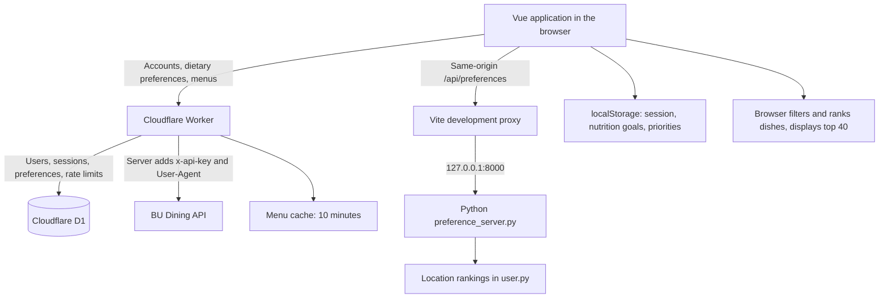

# BU Campus Dining

A dining hall and dish recommendation project for Boston University students. Sign in, save dietary requirements and food preferences, choose which dining halls to include, set nutrition targets, and compare dishes for a selected date and meal.

The application supports Warren Towers (`warren`), West Campus (`west`), and Marciano Commons (`marciano`). The frontend uses Vue 3, Vite, and custom CSS, without a UI component library.

This README describes the current implementation, including its prototype limitations. **The complete local experience requires the Vite frontend, a Python location-preference service, and a reachable Cloudflare Worker. The BU API key belongs on the Worker, not in the frontend.**

## Contents

- [Architecture and request flow](#architecture-and-request-flow)
- [How a recommendation is generated](#how-a-recommendation-is-generated)
- [Feature logic](#feature-logic)
- [Data storage](#data-storage)
- [Worker API and separate AI recommendation pipeline](#worker-api-and-separate-ai-recommendation-pipeline)
- [Local development](#local-development)
- [Build and deployment](#build-and-deployment)
- [Code map and verification](#code-map-and-verification)
- [Troubleshooting and current limitations](#troubleshooting-and-current-limitations)

## Architecture and request flow

The development workspace separates the frontend repository from the backend:

```text
HACKTHON_PROJ/
├── DS-X-Hackathon-Project.github.io/  # This repository: Vue frontend and Python prototype
└── Cloudflare_Part/                  # Separately maintained Worker, migrations, and backend tests
```

`Cloudflare_Part` is outside this Git repository. Cloning this repository does not include the Worker source. Backend descriptions below refer to the accompanying workspace implementation.



### Two different `/api/preferences` endpoints

These paths have the same name but serve different purposes:

| Request | Destination | Methods and data |
| --- | --- | --- |
| `VITE_API_BASE_URL + /api/preferences` | Worker | GET / PUT: dietary labels and food keywords for the signed-in account |
| Same-origin `/api/preferences` | Python through the Vite development proxy | GET / POST: a shared list of dining hall rankings |
| `VITE_API_BASE_URL + /api/v1/dining/locations/{id}/menu` | Worker | GET: authenticated access to BU menus |

Menu requests no longer use a Vite-to-BU proxy. The browser sends the user's session token to the Worker, which adds its BU API key to the upstream request. The BU key is not sent to the browser or included in the frontend bundle.

## How a recommendation is generated

1. `src/main.js` mounts `App.vue`. The app reads the saved browser session and validates it through the Worker's `/api/auth/me` endpoint.
2. The app shows registration/sign-in when there is no valid session, or the preference and recommendation panels after successful authentication.
3. The user saves dietary needs, food keywords, location rankings, nutrition goals, and ranking priorities in their respective panels. Recommendations use **saved values**; editing a form without saving does not update the recommendation inputs.
4. Clicking **Dish recommendation** reads account dietary preferences from the Worker, location rankings from Python, and nutrition goals and priorities from localStorage.
5. The frontend requests menus concurrently for included locations only. The Worker authenticates each request, validates its date, applies rate limiting, and fetches the menu using the server-side key.
6. The frontend selects the requested meal and flattens `meals → stations → items` into a common dish format.
7. Required dietary labels filter candidates first. The remaining dishes are sorted by the user's three ranking priorities.
8. The first 40 dishes are displayed. The first dish's location becomes **Best pick for you**. The page explains the applied preferences and reports missing keywords or partial menu failures.

## Feature logic

### Account registration, sign-in, and sessions

- Registration accepts a valid `@bu.edu` email address. The server trims the email and converts it to lowercase.
- Passwords must contain 8–128 JavaScript string units. Password whitespace is preserved.
- The Worker stores a PBKDF2-SHA-256 password hash using 100,000 iterations and a random salt, rather than a plaintext password.
- Registration signs the user in automatically. Each sign-in creates a random session token. The browser stores the token and expiry in `bu-auth-session`; D1 stores only the token's SHA-256 hash.
- Sessions last a fixed seven days and do not extend on access. The server decides whether a session has expired. Multiple devices can hold independent sessions.
- Reloading the page calls `/me`. A 401 clears the session and requests sign-in; a temporary network failure preserves the session and offers a retry.
- Signing out revokes the current token on the Worker before clearing local session data. Other sessions remain valid.
- Email ownership verification, password resets, and sign-in brute-force rate limiting are not implemented. Checking an email's domain is not proof of student identity.

### Dietary needs: mandatory filters

The available requirements are Vegetarian, Vegan, Gluten-free, and Halal. Selecting several applies an AND condition: each dish must satisfy every selected requirement.

Vegan dishes also satisfy Vegetarian. Saving Vegan also sets the Vegetarian preference. Other required labels must explicitly be `true`; a missing label does not count as a match. With no dietary labels selected, this filtering stage leaves all candidates eligible.

Dietary requirements always run before ranking. A preferred location or a better nutrition match cannot compensate for failing a required label. Labels come from BU's menu data; the project does not independently verify ingredients, allergens, or preparation practices.

### Food preferences: keyword matching

- Food preferences accept up to 300 characters and are saved with the user's Worker account preferences.
- Ranking splits the text on commas, semicolons, or newlines, removes duplicate keywords, and ignores case and accent differences.
- A dish matches when its name contains the normalized keyword, or when a word longer than two characters from a multiword keyword matches a word in the dish name.
- More matched keywords improve the dish's food-preference rank. This is text matching, not semantic search, translation, or synonym recognition; English dish-name keywords work best.
- Keywords affect ordering only. Dishes with no keyword match remain eligible.
- If a keyword matches none of the candidates remaining after dietary filtering, the page reports it and can suggest up to three dishes with zero keyword matches as alternatives. A missing keyword does not cause all dishes to be rejected.

### Location preferences: ordering and exclusion

Each included location receives a unique rank from 1 to 3; lower values are preferred. The interface prevents duplicate ranks and requires at least one included location before saving or requesting recommendations.

Choosing **Don't want** leaves that location out of the saved list. The frontend will neither request its menu nor include its dishes in the recommendation run.

The Python service writes the list to `LOCATION_PREFERENCES` in `user.py`. It reads the value with AST literal parsing and replaces the file through a temporary file when saving.

**Location rankings are currently shared, not account-specific.** Everyone using the same Python service reads and writes the same file. This part of the prototype has not been migrated to D1.

### Nutrition preferences: optional targets

Users can add targets for Calories, Carbohydrates, Protein, and Saturated Fat. Calories use kcal; the other values use grams. Inputs must be finite numbers between 0 and 100000. Only explicitly added targets participate in ranking.

Although the panel is titled **Daily Nutrition Preferences**, the current algorithm compares **each individual dish** with the entered targets. It does not track daily intake, combine dishes into a meal plan, or accumulate nutrients across meals.

For each dish and selected nutrient:

- A value within ±25% of the target counts as a match. For example, a 20 g protein target accepts 15–25 g.
- Nutrition ranking first prefers dishes matching every target, then dishes matching more targets, then a smaller sum of relative errors: `Σ |dish value − target| / target`.
- With a target of zero, only a dish value of zero matches. A nonzero value contributes infinite distance.
- Missing or non-finite nutrition values do not match and make the total distance infinite, but do not by themselves remove the dish.
- With no saved targets, the nutrition dimension does not affect ordering.

Targets are stored as `{ version: 2, goals: ... }` under `nutritionPreferences` in localStorage. They are browser-local, not synchronized to D1, and not partitioned by account. Reset deletes the saved nutrition targets for that browser origin.

Saving the dietary/food preference form clears the legacy Worker fields `max_calories` and `min_protein` to `null`, preventing old per-dish limits from remaining active invisibly.

### Recommendation priorities: ordered comparisons

Users assign priorities 1–3 to nutrition, food keywords, and location. The defaults are:

1. Nutrition targets.
2. Food keywords.
3. Location ranking.

Changing a priority to an occupied number swaps the affected categories. Saving verifies that the three values are unique. The order is stored under `recommendationPriorities` in localStorage.

The algorithm uses **ordered comparisons, not a weighted total score**. It compares priority 1 first, uses priority 2 only for a tie, then priority 3. If all dimensions tie, it preserves the original candidate order.

For example, with food before location, a keyword-matching dish from West can rank above a nonmatching dish from Warren even when Warren is the user's preferred location. Mandatory dietary filters still apply before either comparison.

### Dates, meals, and result cards

- Dates are calculated in `America/New_York`. The app supports today through six days ahead: seven dates in total.
- Meals are Now, Breakfast, Brunch, Lunch, and Dinner. Now is available only for today; changing to a future date switches Now to Lunch.
- Now uses each location's `current_meal` from the BU response. A location without a current meal or matching menu may contribute no dishes.
- Cards show the dish name, location, meal, station, description, available nutrition values, dietary labels, and BU source links.
- The current menu-based frontend does not request individual ingredient details. Its ingredient section therefore reports that those details are unavailable instead of generating them.
- The page displays at most 40 ranked dishes. Its best location comes from the top dish, not from a separate aggregate score for the entire dining hall.
- Frontend menu expansion retains upstream station items, including some sides, sauces, and create-your-own components. It does not run the station exclusions used by the separate Worker AI pipeline.

### Partial failures and error handling

Menu loading uses `Promise.allSettled`. If one location fails, successful locations remain usable and a warning is displayed. If all locations fail, the app displays an error and deduplicates identical messages.

A Worker 401 means the user's session is invalid and triggers sign-in. BU upstream 401/403 responses are translated to 502 with an administrator-facing explanation, so a BU credential problem does not sign the user out. A missing Worker key returns 503; an upstream timeout can return 504; excessive request frequency returns 429.

The menu endpoint allows 30 requests per user per fixed one-minute window. Loading all three halls counts as three requests. Upstream requests time out after eight seconds; successful menus use a ten-minute Workers cache policy. Cache keys omit the BU API key, and menus are not stored in D1. The frontend menu timeout is 30 seconds.

## Data storage

| Data | Storage | Scope |
| --- | --- | --- |
| Email and password hash | D1 `users` | Per account |
| Hashed session tokens and expiry | D1 `sessions` | Per session |
| Dietary labels, food keywords, legacy nutrition limits | D1 `preferences` | Per account |
| Request counters | D1 `rate_limits` | Per account and rate-limit bucket |
| Browser session token | localStorage `bu-auth-session` | Current browser origin |
| Nutrition targets | localStorage `nutritionPreferences` | Current browser origin, not per account |
| Ranking priorities | localStorage `recommendationPriorities` | Current browser origin, not per account |
| Location rankings | Python service's `user.py` | Shared by that Python service |
| BU menus | Workers Cache API | Reused under a ten-minute cache policy |
| BU_API_KEY | Worker secret; `.dev.vars` for local Worker development | Server-side only |

`localhost`, `127.0.0.1`, different ports, and the deployed domain have separate localStorage. Switching between them may require signing in and saving browser preferences again. Signing out does not clear nutrition goals, ranking priorities, or the shared Python location rankings.

## Worker API and separate AI recommendation pipeline

The Worker base URL is configured through `VITE_API_BASE_URL`. The current default is:

`https://bu-auth-worker.tangyingkai120.workers.dev`

| Method and path | Purpose | Authentication |
| --- | --- | --- |
| `POST /api/auth/register` | Register `{ email, password }` and issue a session | None |
| `POST /api/auth/login` | Sign in and issue a session | None |
| `GET /api/auth/me` | Validate the session and return the user | Bearer token |
| `POST /api/auth/logout` | Revoke the current session | Bearer token |
| `GET /api/preferences` | Read account dietary preferences | Bearer token |
| `PUT /api/preferences` | Save account dietary preferences | Bearer token |
| `GET /api/v1/dining/locations/{location}/menu?day=YYYY-MM-DD` | Read a location's menu | Bearer token |
| `POST /api/recommend` | Run server-side recommendations | Bearer token; not called by the current page |

Errors normally use `{ "error": "English message" }`. Cross-origin access is limited by `ALLOWED_ORIGINS`; preflight allows `Content-Type` and `Authorization`. The Worker supplies `x-api-key` to BU without returning the key to the client.

### The separate `/api/recommend` implementation

The accompanying Worker retains an independent recommendation endpoint accepting `{ date?, meal, locations? }`:

1. Load dietary preferences from D1 and fetch menus concurrently.
2. Normalize and deduplicate dishes, exclude selected condiment/create-your-own/salad-bar stations, and apply dietary and legacy nutrition-limit filters.
3. Limit candidates to 120, taking turns across locations so one hall does not fill the entire candidate list.
4. Try Workers AI with a list of allowed candidate references and validate the model's output against that list.
5. Fall back to deterministic ranking if AI is unavailable, times out, or returns invalid output. Return at most five dishes and attempt to enrich them with ingredient details.

This endpoint allows six requests per user per minute. **It is separate from the current browser's 40-dish ranking flow.** It does not automatically read browser nutrition targets or ranking priorities, and the current page should not be described as using AI to rank its results.

## Local development

### Recommended: local frontend and Python, deployed Worker

Requirements: Node.js 22.12 or later, npm, and Python 3. Run the following in this repository's root.

Install dependencies and create local configuration:

```powershell
npm ci
# Copy only if .env.local does not already exist; preserve existing settings.
Copy-Item .env.example .env.local
```

The frontend `.env.local` only needs the public Worker address:

```dotenv
VITE_API_BASE_URL=https://bu-auth-worker.tangyingkai120.workers.dev
```

Start the location-preference service in one terminal:

```powershell
python preference_server.py
```

Start the frontend in another:

```powershell
npm run dev
```

Open http://localhost:5173 or http://127.0.0.1:5173 and use the same address consistently. Vite uses a strict port of 5173; if a server is already listening, use it rather than starting another instance.

Sign in, save the settings in each preference panel, select a date and meal, and request recommendations. The default Worker uses live accounts and live dietary preferences, not mock data.

### Optional: run the Worker locally

Obtain the accompanying `Cloudflare_Part` directory separately. From that directory:

```powershell
npm ci
Copy-Item .dev.vars.example .dev.vars
# Set BU_API_KEY in .dev.vars for the local Worker only.
npm run db:migrate
npm run dev
```

Set the frontend's `VITE_API_BASE_URL` to `http://127.0.0.1:8787` and restart Vite. The Python service is still required. Local D1 and production D1 are separate, so production accounts are not automatically available locally. The Workers AI binding can involve remote services; a local Worker does not imply fully offline operation.

**Never put BU_API_KEY in the frontend `.env.local`, and never put secrets in variables prefixed with `VITE_`.**

## Build and deployment

```powershell
npm run build          # Build for hosting at a site's root.
npm run build:pages    # Build for the GitHub Pages repository subpath.
npm run preview -- --host 127.0.0.1
```

Build output goes to `dist/`. Preview serves the built files for inspection; it is not the development server. Production configuration includes the public Worker URL in `.env.production`, but local overrides can change the effective URL. Check the intended backend before building. Vite development proxies do not become part of the static build.

### GitHub Pages

`.github/workflows/deploy.yml` runs on pushes to `main` or manual dispatch. It installs dependencies, runs `build:pages`, uploads `dist`, and deploys to Pages. In the repository's **Settings → Pages → Build and deployment**, select **GitHub Actions** as the source.

Target URL: https://kamkamkamkjst824.github.io/DS-X-Hackathon-Project.github.io/

Deploy the built files, not the source repository root. The source `index.html` references `/src/main.js`, which requires Vite processing. Publishing it directly can produce a 404 or unresolved modules and a blank screen. `build:pages` adds the `/DS-X-Hackathon-Project.github.io/` asset prefix.

**Static deployment does not deploy the Python service.** The deployed frontend can use Worker authentication, account preferences, and menu endpoints, but location rankings still request the page's same-origin `/api/preferences`. GitHub Pages provides no such endpoint, so the complete recommendation flow will fail when loading location rankings. Before a full public release, migrate location rankings to authenticated cloud storage and update those frontend calls.

### Cloudflare Worker

Deploy backend changes from the separate `Cloudflare_Part` directory. Pushing this frontend repository does not deploy the Worker.

```powershell
npx wrangler login
# Initial key setup or rotation: enter the key interactively, not in source code.
npx wrangler secret put BU_API_KEY
# Run when there are pending D1 migrations.
npm run db:migrate:remote
npm run deploy
```

Configure the intended D1 binding and `ALLOWED_ORIGINS` in `wrangler.jsonc`. For GitHub Pages, the origin is `https://kamkamkamkjst824.github.io`, without the repository path. Existing deployments do not need a new database or a repeated secret update when those values have not changed.

## Code map and verification

| File | Responsibility |
| --- | --- |
| `src/App.vue`, `src/auth.js` | Account UI, session restoration, sign-out |
| `src/api.js` | Worker URL, Bearer tokens, JSON requests, errors |
| `src/dining.js` | Worker menu loading, meal selection, normalization, partial failures |
| `src/recommendationRanking.js` | Dietary filters, keyword matching, nutrition distance, ordered ranking |
| `src/components/PreferencesForm.vue` | Account dietary labels and food keywords |
| `src/components/LocationPreference.vue` | Python location ranking reads and writes |
| `src/components/NutritionPreferences.vue` | Browser-local nutrition targets |
| `src/components/RecommendationPriorities.vue` | Priority editing, swapping, and storage |
| `src/components/RecommendPanel.vue` | Request orchestration, explanations, best location, 40-result limit |
| `src/components/RecommendationCard.vue` | Individual dish presentation |
| `preference_server.py`, `user.py` | Active local location-preference service and data |
| `vite.config.js` | Vue integration, port 5173, Python proxy, test configuration |
| `.github/workflows/deploy.yml` | Frontend Pages build and deployment |

Other Python prototype files remain in the repository. The active location-preference proxy uses the singular **`preference_server.py`**, not `preferences_server.py`.

Frontend checks:

```powershell
npm test
npm run build:pages
git diff --check
```

Checks from the accompanying Worker directory:

```powershell
npm test
npm run check
```

Frontend tests cover authenticated menu calls, partial failures, session expiry, dietary and keyword ranking, nutrition goals, location exclusion, priority order, and the result limit. Worker tests use isolated Miniflare/D1 instances for accounts, input validation, CORS, menu proxying, upstream authentication errors, and recommendation fallback. They do not use the production database as a test database.

## Troubleshooting and current limitations

| Symptom | What to check |
| --- | --- |
| Pages is blank; `/src/main.js` returns 404 | Build and deploy `dist` with the correct base path. |
| Location rankings cannot load or save | Run `python preference_server.py` and use the Vite development server. |
| An old error requests BU_API_KEY in frontend `.env.local` | Update the frontend; menu calls should now go to the Worker. |
| New BU authentication failure / 502 | Check the Worker's BU_API_KEY and upstream access permissions. |
| Session 401 | Sign in again; changing the BU key does not repair a user session. |
| Cross-origin 403 | Check ALLOWED_ORIGINS; localhost and 127.0.0.1 are different origins. |
| 429 | Wait for the rate-limit window to reset before retrying. |
| No dishes | Check the date, meal, operating hours, and dietary restrictions. |
| Nutrition goals disappear in another browser | They currently live in localStorage without cloud synchronization. |
| Local development works but static preview/Pages recommendations fail | The Python location endpoint is available only through the development proxy. |

The project remains a prototype: location rankings are shared, while nutrition goals and priorities are browser-local. Preferences are not yet unified in account-level cloud storage. Menus can change, nutrition targets are not a daily meal plan, and menu labels do not replace direct allergen confirmation with dining staff.
